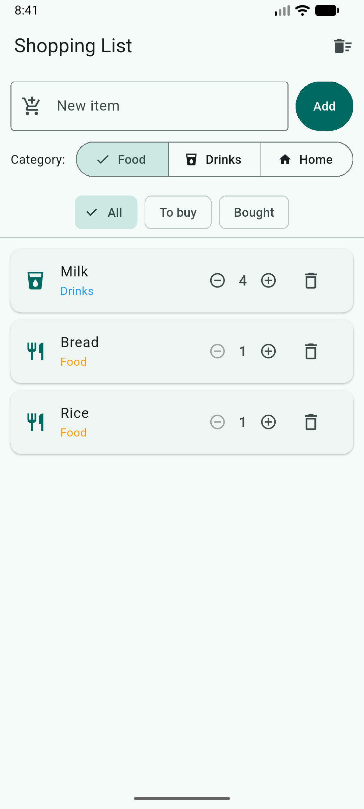
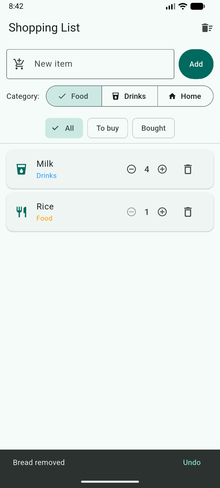
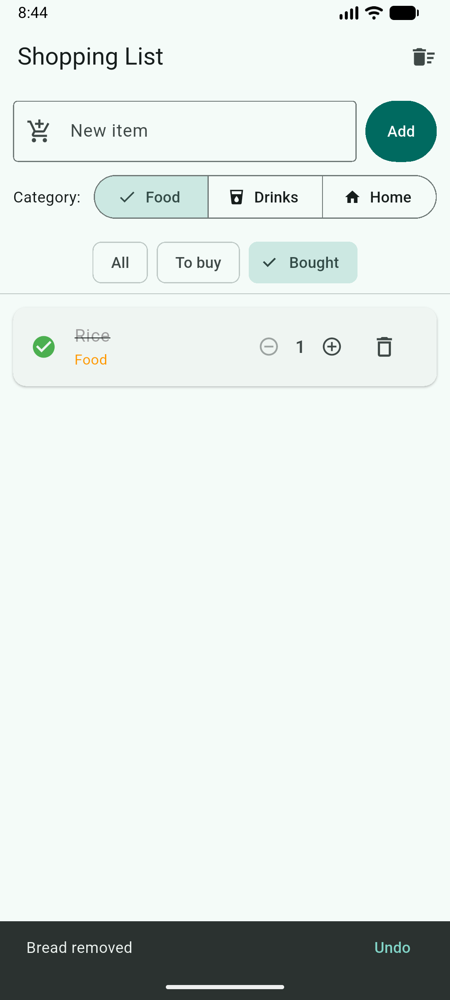
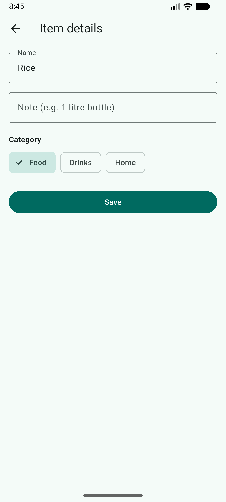
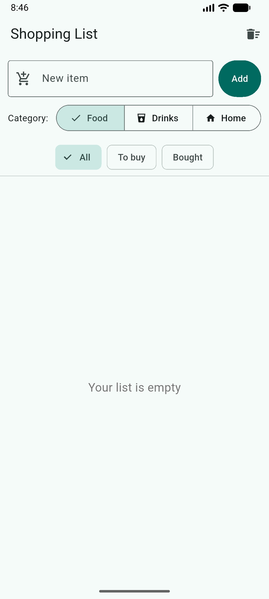
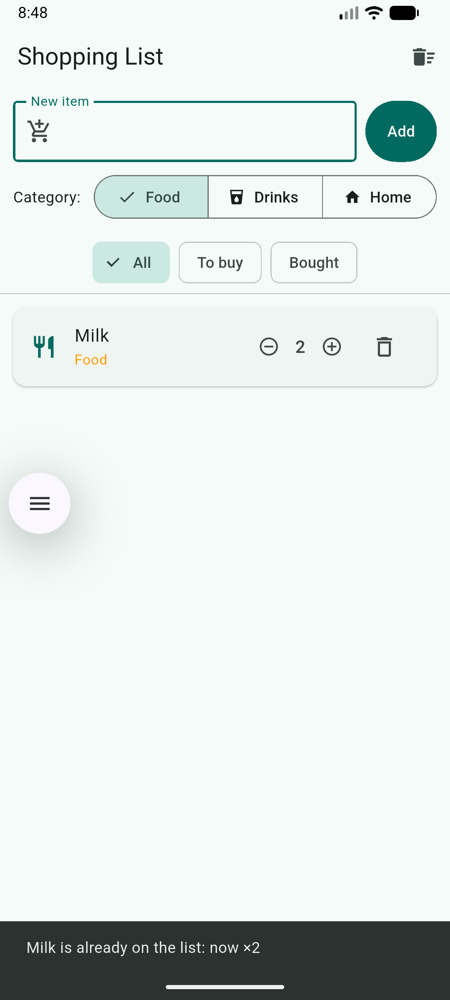

# Shopping List+

A Flutter shopping list app with quantities, duplicate detection, undo, filters, and a details screen per item.

Week 2 · Session 3 · Mobile Programming · Innovation Center

---

## Features

The six upgrades from the assignment:

1. **Empty state** — when the list has no items, the page shows `Your list is empty` in the middle. When a filter hides everything, it says `Nothing here`.
2. **Quantities** — every item shows `− 1 +` controls. `+` adds one, `−` subtracts one and never goes below 1. The bin removes the item.
3. **No duplicates** — adding an item that already exists (case-insensitive, spaces ignored) raises its quantity and shows `Milk is already on the list: now ×2`. A new item is added as normal.
4. **Undo** — deleting an item shows a `... removed` message with an `Undo` button. Undo restores the item to its original position, with its quantity, note and bought state intact.
5. **Filters** — three chips: `All`, `To buy`, `Bought`. The selected chip is highlighted. In `All`, bought items sit at the bottom.
6. **Item details** — long-press an item to open a details screen. Edit name, note, and category; Save keeps the changes and returns to the list; the back arrow discards them. An empty name is refused with a message.

---

## Screenshots

### Quantities


### Undo message


### Bought filter


### Item details screen


### Empty state


### Duplicate detection


---

## How to Run

```bash
git clone <https://github.com/Emmalise1/shopping_list>
cd shopping_list
flutter pub get
flutter run
```

Requires Flutter 3.x or later and an Android emulator or device.

---

## Think

**1. In part 5, why does deleting by index remove the wrong item when a filter is on? How did you fix it?**

When a filter is active, the list shows `visibleItems` — a subset of the underlying `items` list. Row `0` on the screen might correspond to `items[3]` in the real list, and rows get re-ordered by the "bought items at the bottom" sort. If the delete handler received the *visible* index, `items.removeAt(index)` removed a different item. The fix: pass the `Item` object itself into `deleteItem`, then resolve its true index inside the function using `items.indexOf(item)` before removing. The UI layer never supplies a raw index — it supplies an identity.

**2. Why did you have to remove `final` from `name`? Why is `final` still a good choice for most fields?**

`final` in Dart means "assigned once, never changed." The details screen needs to rename an item after creation, so `name` must be mutable. Removing `final` allows the change. `final` is still a good default for most fields because most values never change after construction — a user ID, a creation timestamp, a product code. Marking them `final` prevents accidental mutation elsewhere in the code and lets the compiler catch bugs.

**3. Why did you need a hot restart after adding `quantity` to `Item`, when a save was enough for everything else?**

Hot reload re-runs the `build()` methods of your widgets but does not recreate existing object instances. Adding a new field to the `Item` class changes the shape of the class, so any `Item` already instantiated (Milk, Bread, Rice, created before the change) is missing the field. Hot restart tears down the app and re-runs `main()`, reconstructing every object from scratch with the new shape.

**4. The details screen changed the item, but the list only showed it after `setState` in `.then`. Why?**

The `Item` object is passed by reference to the details screen. When the details screen mutates it, the data changes, but the list screen's `State` object has no way of knowing. Flutter only redraws when `setState` is called on the owning State. Without `setState` after `Navigator.push(...).then(...)`, the list continues to display the previously-rendered widgets, which happen to look identical even though the underlying data is different. Calling `setState(() {})` marks the State dirty, and Flutter rebuilds the widget tree on the next frame.

---

## Tech

- Flutter 3.x
- Dart 3.x
- Material 3

---

## Author

IZA KURADUSENGE Emma Lise — 28246